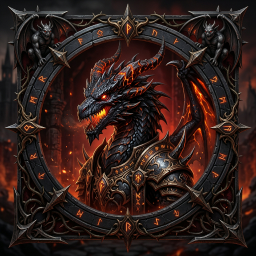

# 🏛️ DRACONIC SANCTUM — 竜石の聖域
### 竜石のゴシック大聖堂決戦 (3D Stone Dragons Edition)

古代のゴシック大聖堂と崩れたルーン魔法陣の祭壇で繰り広げられる、重厚な石造古竜チェスバトル。



---

## ⚔️ 特徴 (Features)

- **6種の石造古竜 3Dモデル (`.glb`)**:
  - 👑 **双覇王古竜 (King)**: 巨大な角と王冠角、アンダーバイト牙を持つ覇竜
  - 👸 **長老古竜 (Queen)**: 4本の威厳ある角と巨大な翼を持つ至高の古竜
  - 🧙 **双頭の秘術竜 (Bishop)**: とぐろを巻く蛇竜胴体と交差する2つの龍頭を持つヒドラ
  - 🐎 **有翼飛竜 (Knight)**: 飛翔するワイバーンシルエット
  - 🏰 **要塞重竜 (Rook)**: 鉄壁の防壁と背部キャノンを持つ重装歩行竜
  - 🛡️ **ドレイク幼竜 (Pawn)**: 四足歩行で前進する幼竜
- **本格的なPBRマテリアル**:
  - 2K解像度の岩肌・鱗テクスチャ（アルベド・法線・粗さ・アンビエントオクルージョン・ルーン発光）
  - 白竜石（純白大理石＋シャンパンゴールド） vs 黒曜竜（漆黒黒曜石＋深紅ルーン）
- **フルアニメーションリグ**:
  - 全駒に「待機 (Idle)」「飛翔進撃 (Move)」「竜撃咆哮 (Attack)」「被弾咆哮 (Hit)」の4モーション搭載
- **古代聖譚詩BGM & 聖堂効果音 (SE)**:
  - 『Beyond the Great Crest』オーケストラBGMおよび大理石破壊音・竜撃音を内蔵
- **単一完結スタンドアロンHTML (`wizards-chess-standalone.html`)**:
  - 外部サーバー不要。ブラウザでダブルクリックするだけで全アセット内蔵で完全動作！

---

## 🎮 遊び方 (How to Play)

### すぐに遊ぶ場合
リポジトリ内の `wizards-chess-standalone.html` をダウンロードし、お使いのWebブラウザ（Chrome, Edge, Firefox, Safariなど）で開くだけで即座にプレイ可能です。

### 開発・ローカル起動
```bash
# 依存関係のインストール
npm install

# 開発サーバー起動
npm run dev

# プロダクションビルド
npm run build

# 単一完結スタンドアロンHTMLの再生成
npm run build:standalone
```

---

## 📜 操作方法
- **左クリック**: 駒の選択 / 移動先ルーン聖痕の指定
- **ドラッグ (左ドラッグ)**: 聖堂の3D視点回転
- **右ドラッグ**: 平行移動
- **マウスホイール**: ズームイン / ズームアウト
- **右側コントロールパネル**:
  - 視点プリセット（白竜の岩座、黒竜の岩座、魔法陣祭壇俯瞰、大聖堂全景、解剖マクロ鑑賞）
  - 古竜の土台形態（岩座あり / 土台なし）
  - AI対局モード切替、BGM/効果音切替

---

## 🏛️ ライセンス / 権利表記
**© 2026 yuki1sakai1-code. All Rights Reserved.**  
本リポジトリの全プログラムコード、3Dモデル、画像、音源アセットは私的利用・個人の鑑賞を目的としたプライベート作品です。権利者の許可なく複製、改変、再配布、商用利用、またはAIモデル等の学習データとして使用することを固く禁じます。

